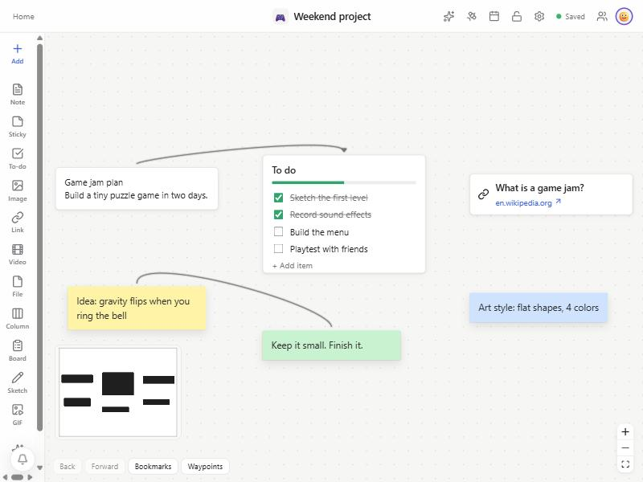
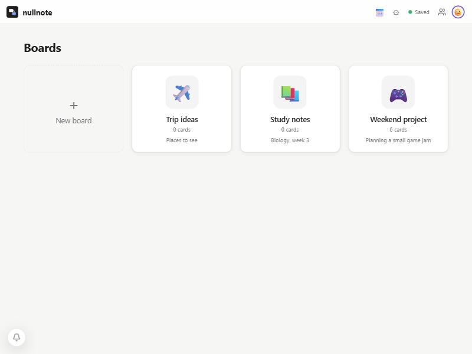

# nullnote

> **Beta.** nullnote is a personal project that is still being built. Expect bugs.

A local-first visual notes app: boards, an infinite canvas and cards.

## What it can do

- Boards with notes, sticky notes, to-do lists, images, links, videos, files, sketches, columns and 3D model cards
- Connectors between cards, including a string style
- Per-board colors and app themes
- Sharing boards directly between people, with permissions
- Word and PowerPoint import and export
- Optional AI helper using your own API key
- Desktop app builds as well as the web version

Many features have not been tested by real users yet.

## How it was made

Built as a personal project, with AI coding tools doing much of the coding.
React, TypeScript, Vite, Dexie and Electron.

## Want to try it?

Access is by request. [Open a request](../../issues/new?title=Access+request) and say a little about what you would use it for.

Requests are **public**, so do not include your email address or any other personal information.

## Before you use it

- It is beta software, provided as is, with no warranty. Things can break and data can be lost, so keep backups.
- It has not had a professional security review.
- Do not store passwords or other sensitive information in it.
- Found a security problem? Do not post the details publicly. Open an issue that only says you have a security report, and wait for a reply.

## Rights

Copyright FelinorLover. All rights reserved. This page is a showcase and does not include the source code.
